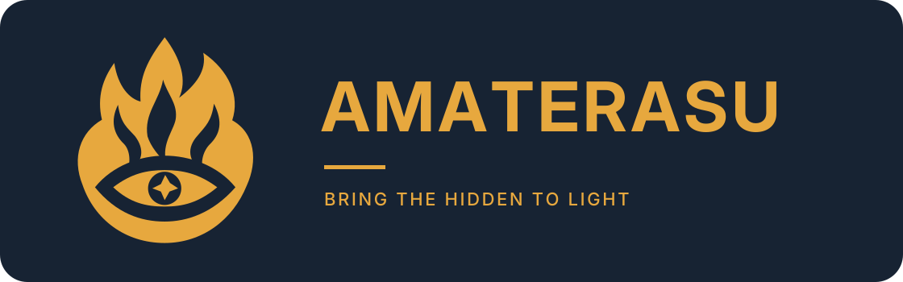

# Amaterasu

<p align="center">
  
</p>

**Give Kagami a URL or pasted text to review its claims, reasoning, numbers, and
promises.** You get a short verdict, up to five findings with quotations and
evidence, and an explanation of what Kagami could check.

Amaterasu provides four skills, which are instructions and references your AI
assistant loads for a specific task. Start with Kagami for a critical review.

| Skill | What it does |
| --- | --- |
| [Kagami](skills/kagami/SKILL.md) · 鏡 · *mirror* | Review claims and arguments for empty language, missing support, and misleading reasoning. |
| [Kotoba](skills/kotoba/SKILL.md) · 言葉 · *words* | Draft or revise writing while preserving facts, voice, uncertainty, and commitments. |
| [Kakehashi](skills/kakehashi/SKILL.md) · 架け橋 · *bridge* | Explain material to a specific audience while preserving its meaning and qualifications. |
| [Mamoru](skills/mamoru/SKILL.md) · 守る · *protect* | Clarify commitments, boundaries, and documented conduct, then suggest a proportionate response. |

**Example claim**

```text
Defects fell from 2% to 1%, a 50-percentage-point decrease.
```

**Illustrative response**

> The decrease is **1 percentage point**, or **50% relative**. Checking the
> measurements or explaining the change requires more evidence.

Amaterasu is experimental. Review quality depends on the host model and the
sources it can access.

## Contents

- [Install](#install) ([Claude Code](#claude-code), [Codex](#codex), [OpenCode](#opencode), [Pi](#pi))
- [Examples and use cases](#examples-and-use-cases)
- [Optional companions](#optional-companions)
- [Source access and privacy](#source-access-and-privacy)
- [Method and feedback](#method-and-feedback)
- [Why Amaterasu?](#why-amaterasu)
- [License](#license)

## Install

Choose one route for your host. The plugins install all four skills. The
OpenCode and Pi commands install Kagami only and use the Skills CLI, which
requires Node.js and npm. You can use the skills without Python.

For other installation scopes, updates, manual copying, and troubleshooting,
see the [installation guide](docs/installation.md). For tested versions and
runtime limits, see the [installation check record](eval/phase-6-verification.md).
Runtime checks passed on Codex and OpenCode. Pi installation and update were
exercised, but the Pi runtime was unavailable. Claude Code was unavailable, so
its installation and runtime checks are outstanding.

### Claude Code

Run these commands in the project where you want to use Amaterasu.

```sh
claude plugin marketplace add ThomasBury/amaterasu --scope project
claude plugin install amaterasu@amaterasu --scope project
```

Start a new session in that project and send this prompt.

```text
/amaterasu:kagami Review this claim. Defects fell from 2% to 1%, a 50-percentage-point decrease.
```

### Codex

These commands install the plugin for your user.

```sh
codex plugin marketplace add ThomasBury/amaterasu
codex plugin add amaterasu@amaterasu
```

Start a new session. Select Kagami from `/skills` or the `$` picker using the
name shown in the catalog, then send this prompt.

```text
Review this claim. Defects fell from 2% to 1%, a 50-percentage-point decrease.
```

### OpenCode

Run this command in the project where you want to use Kagami.

```sh
npx skills@latest add ThomasBury/amaterasu --skill kagami -a opencode
```

Start a new session in that project and send this prompt.

```text
Use the kagami skill to review this claim. Defects fell from 2% to 1%, a 50-percentage-point decrease.
```

### Pi

Run this command in the project where you want to use Kagami.

```sh
npx skills@latest add ThomasBury/amaterasu --skill kagami -a pi
```

Run `/reload` or start a new session in that project, then send this prompt.

```text
/skill:kagami Review this claim. Defects fell from 2% to 1%, a 50-percentage-point decrease.
```

## Examples and use cases

Use the Kagami invocation for your host with the prompts below. When you
review your own material, include your decision, any relevant dates, and the
evidence you already have.

### Check numbers in a public announcement

```text
Review NASA's 2022 DART announcement. Check the change in orbit period and separate the measured result from possible future uses.
https://www.nasa.gov/news-release/nasa-confirms-dart-mission-impact-changed-asteroids-motion-in-space/
```

The reported periods differ by 32 minutes. A review can check that arithmetic
and preserve the reported uncertainty of about two minutes. [NASA’s DART announcement](https://www.nasa.gov/news-release/nasa-confirms-dart-mission-impact-changed-asteroids-motion-in-space/)

### Review a paper abstract

```text
Review only the abstract of Attention Is All You Need. Which claims does it report, and which comparisons would require checking the methods or results tables?
https://arxiv.org/abs/1706.03762
```

The abstract reports results for specific translation tasks. Checking whether
the training comparisons are fair requires details beyond the abstract.
[Attention Is All You Need](https://arxiv.org/abs/1706.03762)

### Compare with existing coverage

```text
Review the new post and compare it with the supplied article.
Briefly state what overlaps, what the post adds, and what remains unchecked.
New post: [paste text and date, if known]
Comparison article: [paste text and date, or link]
```

To find comparison material too, add: “Also search for similar public articles,
posts, or videos.” Kagami reads the post and supplied sources first. When
discovery is requested and public research is permitted, Kagami is instructed
to reserve two of six searches for discovery before any corroboration searches.
Claim checks can use the sources discovery finds and any unused slots. A match
counts as repeating earlier coverage only when that passage
is known to predate the post. Kagami reports additions relative to the sources it
inspected and distinguishes added assertions from added evidence. Video coverage
depends on accessible transcripts and visuals.

## Optional companions

Invoke each companion separately by name using your host’s invocation pattern.
If you installed only Kagami, copy the companion’s full folder before using it. See the
[manual installation instructions](docs/installation.md#manual-installation).

These short examples use fictional inputs.

### Kotoba for revising an update

```text
Tighten this update for my manager. Keep the uncertainty and condition.
“We may finish in June if the migration succeeds.”
```

The revision should still make June conditional on a successful migration.

### Kakehashi for explaining a result

```text
Explain this result to a nontechnical manager.
“Defects fell from 2% to 1% in our pilot. We have not tested production.”
```

The explanation should make the size of the change clear and keep the
conclusion limited to the pilot. To explain a Kagami review, invoke Kakehashi
with the findings, original wording, sources, and open questions.

### Mamoru for clarifying a commitment

```text
A vendor wrote, “If the pilot succeeds, I will recommend renewal to the committee.”
What has the vendor promised? Suggest one follow-up question.
```

The vendor has promised a recommendation if the pilot succeeds. A useful
follow-up is to ask what counts as a successful pilot.

## Source access and privacy

Kagami can review pasted posts, articles, and papers without browsing. For a URL,
access depends on your host’s tools. If a page is blocked, paste the relevant text
or supply an export. If only a paper’s abstract is available, the review covers
the abstract and identifies what would require the methods or tables.

For **YouTube**, use Kagami to review claims or Mamoru to examine commitments.
If the host cannot retrieve captions, paste a transcript with the link and
timestamps. A transcript covers spoken content. Supply any chart or screenshot
the review also needs.

For private material or material whose public status is unclear, Kagami uses
supplied evidence unless you authorize a safe public search. A cloud-backed host
may send prompts to its model provider even when skill files are local. Sending
messages, publishing, and changing external records require separate
authorization.

## Method and feedback

The skills separate what a source says, what its evidence supports, and what
follows from it. They distinguish missing evidence from contradictory evidence
and assess the material without scoring people or inferring intent from a
missed promise.

- [Skill contracts](docs/contracts.md) describe each skill’s intended behavior.
- [Evidence register](docs/evidence.md) explains the methods and their limits.
- [Evaluation guide](eval/README.md) gives file checks and manual review scenarios.
- [Roadmap](MILESTONES.md) records completed work and proposed research.

To report a problem, share a nonconfidential example, your host and model, and
what Kagami missed, unfairly flagged, or made unnecessarily verbose.

## Why Amaterasu?

Amaterasu takes its name from the sun goddess of Japanese mythology. A mirror
helps draw her out of a cave and restore light to the world. Kagami is the
mirror. The companions attend to words, bridge understanding, and protect
boundaries. [Amaterasu’s story](https://www.mlit.go.jp/tagengo-db/en/R1-00756.html)

## License

Original project material is available under the MIT license. See the
[license](LICENSE) and [attribution notice](NOTICE.md).
